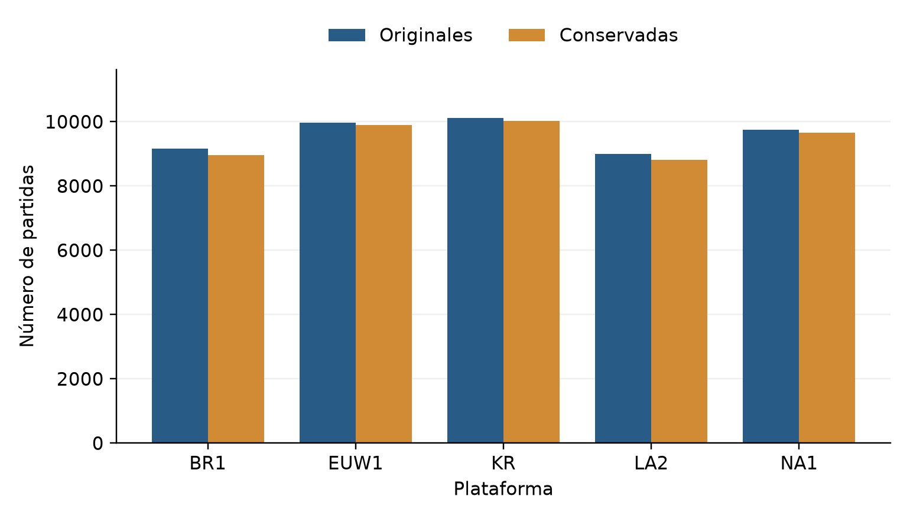
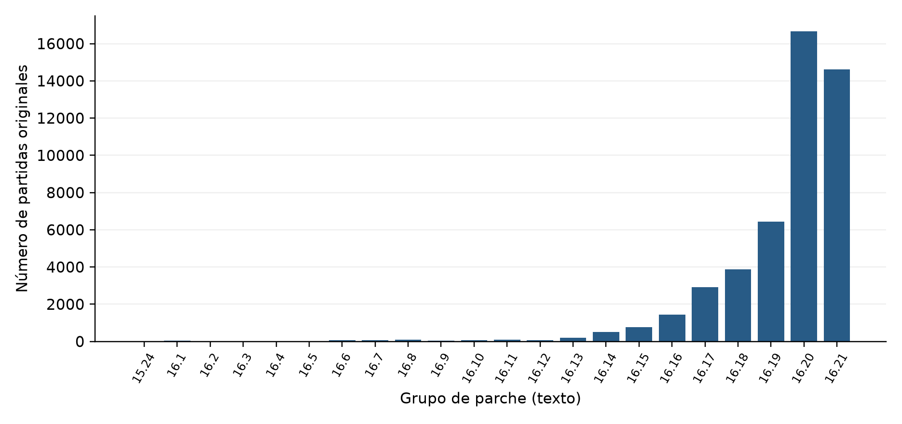

# Preparación y validación de datos de League of Legends para el descubrimiento de patrones estratégicos

**Proyecto universitario de Minería de Datos**  
**Fecha del informe:** 8 de noviembre de 2026.  
**Muestra analizada:** 48.000 partidas históricas de cinco plataformas.  
**Etapa documentada:** análisis exploratorio, preprocesamiento y preparación para minería.

**Resumen.** Este informe describe la preparación de un conjunto de datos históricos de League of Legends para investigar patrones estratégicos y, posteriormente, estudiar su aplicación en un sistema de recomendaciones contextuales. La muestra original contiene 48.000 partidas y 6.634.160 eventos. Tras aplicar un criterio de duración mínima de cinco minutos, se conservaron 47.323 partidas y 6.633.503 eventos. A partir de ellos se construyeron 225.466 estados temporales. La preparación posterior produjo 450.344 estados desde la perspectiva de cada equipo, igual número de transacciones y 94.526 secuencias históricas, excluyendo las partidas purgadas de los experimentos. Se superaron 99 comprobaciones de integridad y coherencia de los datos. Los resultados corresponden a la preparación de los datasets; todavía no demuestran la existencia de patrones útiles ni la eficacia de un sistema de recomendaciones.

## 1. Introducción y descripción del proyecto

League of Legends genera información sobre la composición de los equipos, los acontecimientos de una partida y su resultado. El análisis de estos registros permite formular preguntas sobre la evolución de las ventajas, los momentos en que se obtienen objetivos y el orden en que se producen determinados acontecimientos. Para responderlas mediante minería de datos es necesario convertir los registros originales en estructuras que representen situaciones y secuencias comparables.

El proyecto tiene como propósito descubrir patrones estratégicos en partidas históricas y evaluar, en una etapa posterior, si pueden aportar información contextual a los jugadores. La aplicación futura podría consultar la Live Client Data API para obtener datos de una partida activa. Riot documenta esta API como una fuente local de información del cliente de juego; su uso deberá evaluarse junto con los requisitos de integridad del juego y la disponibilidad real de cada variable. [R1](https://developer.riotgames.com/docs/lol)

La etapa descrita en este documento se concentra en las condiciones necesarias para realizar ese análisis: calidad de las fuentes, interpretación de las versiones, integración entre tablas, tratamiento de valores desconocidos y construcción de estados y secuencias sin información posterior al instante estudiado. El resultado es una base reproducible para tres líneas de investigación: reglas de asociación, patrones secuenciales y relaciones entre estados parciales y resultados posteriores.

La investigación se sitúa en el ámbito de la minería de telemetría de videojuegos. Drachen y colaboradores describen este campo como la obtención de conocimiento a partir de registros de juego, con atención a su calidad y escala. Los estudios de Yang y colaboradores sobre eventos en *Honor of Kings* y de Silva Junior y Campelo sobre resultados de League of Legends aportan antecedentes para estudiar información observada durante una partida. Sus datos y tareas son diferentes de los de este proyecto; constituyen un fundamento para formular preguntas, sin trasladar automáticamente sus resultados a esta muestra ni demostrar la utilidad de una recomendación. [C1](https://doi.org/10.1007/978-1-4471-4769-5_12), [C5](https://arxiv.org/abs/2012.09424), [C6](https://arxiv.org/abs/2309.02449)

## 2. Planteamiento del problema y objetivos

### 2.1. Planteamiento del problema

Los registros recolectados no tienen inicialmente una estructura única adecuada para todas las técnicas de minería. Un resumen contiene información final de una partida; un evento describe un acontecimiento individual; un hito registra una primera captura. Unirlos sin considerar sus tiempos puede introducir información que todavía no existía en el momento que se pretende analizar.

Además, hay diferencias entre los conteos del resumen y del timeline, actores sin equipo atribuible, rangos desconocidos y objetivos cuya disponibilidad puede cambiar entre versiones. El volumen del archivo original de eventos, superior a 21 GB, también exige un procesamiento que controle el uso de memoria.

El problema abordado consiste en transformar estas fuentes heterogéneas en datos verificables, temporalmente coherentes y adecuados para descubrir patrones, preservando su procedencia y las incertidumbres que no pueden resolverse con la información disponible.

### 2.2. Objetivo general de la investigación y objetivo de esta entrega

**Objetivo general de la investigación.** Descubrir y evaluar patrones temporales y combinaciones de eventos estratégicos en partidas de League of Legends, y utilizarlos como base para diseñar y evaluar un sistema de recomendaciones contextuales que aporte información al jugador a partir del estado observable de su partida.

**Objetivo de esta entrega.** Preparar, validar y documentar el conjunto histórico y sus representaciones temporales para permitir el descubrimiento posterior de esos patrones, preservando la trazabilidad de las fuentes y evitando incorporar información futura como entrada.

El objetivo general abarca la investigación completa. Esta entrega desarrolla la comprensión y preparación de los datos; la minería, la evaluación de los patrones y la construcción y validación del sistema contextual corresponden a etapas posteriores. La integración en vivo dependerá de que las características necesarias estén disponibles y de que las funciones propuestas sean compatibles con el alcance permitido por Riot.

### 2.3. Objetivos específicos

1. Caracterizar, limpiar y validar las fuentes históricas, normalizando identificadores, tipos y unidades y documentando los valores desconocidos y las discrepancias.
2. Construir estados, transacciones y secuencias desde perspectivas simétricas de equipo, utilizando exclusivamente la información observada hasta cada corte.
3. Identificar combinaciones de eventos estratégicos mediante reglas de asociación y examinar su relación con resultados posteriores.
4. Descubrir secuencias frecuentes de bajas y objetivos, conservando el orden temporal y la simultaneidad de los eventos.
5. Evaluar la estabilidad y relevancia de los patrones en periodos posteriores y según contexto, controlando fugas de información, redundancia y dependencia entre observaciones.
6. Diseñar un mecanismo que relacione el estado observable de una partida con patrones históricos y presente información contextual respaldada por evidencia.
7. Evaluar la disponibilidad de características en vivo y la utilidad, claridad y oportunidad de las recomendaciones del prototipo futuro.
8. Documentar decisiones, archivos, pruebas y limitaciones para hacer reproducible cada etapa de la investigación.

Esta entrega aporta resultados a los objetivos 1, 2 y 8 y establece las condiciones experimentales del objetivo 5. Los objetivos de descubrimiento, evaluación de patrones y desarrollo del sistema todavía no se consideran cumplidos.

### 2.4. Preguntas de investigación

**Pregunta principal.** ¿Qué patrones temporales y combinaciones de eventos estratégicos se encuentran asociados con la victoria en League of Legends y cómo pueden utilizarse, una vez evaluados, como base de recomendaciones contextuales para los jugadores?

Las preguntas específicas son:

1. ¿Qué combinaciones de diferencias en bajas, dragones y torres, observadas en cortes temporales definidos, se asocian con la victoria posterior y mantienen esa relación en los periodos de validación y prueba?
2. ¿Qué secuencias de bajas y objetivos aparecen con frecuencia y cómo varían su presencia y su relación con el resultado según el minuto, la composición o el grupo de parche?
3. ¿Qué patrones pueden relacionarse con las variables realmente disponibles en vivo y qué criterios de evidencia, claridad y oportunidad permiten convertirlos en información contextual útil?

Las dos primeras preguntas orientan el análisis de los datos históricos; la tercera requiere además capturas y evaluación del prototipo en vivo. En esta entrega se habilita su investigación mediante datos preparados y validados, sin presentar respuestas empíricas que todavía no se han obtenido. La relación con la victoria se estudiará como asociación observacional y no como prueba causal de una decisión.

## 3. Descripción de las fuentes de datos

### 3.1. Procedencia y alcance de la muestra

Los datos históricos fueron recolectados mediante la API de Riot Games. La selección parte de jugadores de los niveles Master, Grandmaster y Challenger y contempla las plataformas KR, EUW1, NA1, BR1 y LA2. Esta procedencia no garantiza que todos los participantes tengan el mismo nivel ni que su rango histórico se conozca.

La muestra contiene 48.000 partidas iniciadas entre el 2 de enero y el 2 de noviembre de 2026, según sus marcas temporales UTC. Se compone de 39.952 partidas de una muestra anterior y 8.048 incorporadas en una ampliación; estas últimas pertenecen a los grupos de parche `16.20` y `16.21`.

La información original se organiza en tres datasets relacionados:

| Dataset original | Unidad de observación | Filas | Columnas | Contenido principal |
|---|---|---:|---:|---|
| Resumen de partidas | Una partida | 48.000 | 49 | Composición por rol, versión, duración, rango promedio conocido, resultado y objetivos finales. |
| Eventos individuales | Un evento registrado | 6.634.160 | 22 | Tiempo, tipo, actores, objetivos, coordenadas cuando existen y detalle original del evento. |
| Hitos de partida | Una partida | 48.000 | 18 | Equipo y tiempo de la primera captura de ocho tipos de hito. |

### 3.2. Relaciones, identificadores y unidades

La clave `match_id` relaciona las tres fuentes. Los eventos poseen un `event_id` compuesto por la partida y los índices de frame y evento. En la nomenclatura del resumen, `t1` corresponde al equipo 100 y `t2` al equipo 200.

Las unidades temporales se interpretan de la siguiente forma:

| Campo | Interpretación |
|---|---|
| `game_creation` | Tiempo Unix en milisegundos; identifica el inicio de la partida. |
| `game_duration` | Duración total en segundos. |
| `timestamp_ms` | Milisegundos transcurridos desde el inicio del juego. |
| `first_*_time` | Tiempo del hito en milisegundos desde el inicio. |
| `minute` / `game_minute` | Minutos transcurridos desde el inicio. |

La columna `team_id` de un evento puede representar al propietario de una estructura destruida. Para contar capturas a favor de un equipo se utiliza `actor_team_id`, que identifica al equipo al que el recolector atribuye la acción. Los identificadores de participantes se conservan, pero no se supone que su numeración determine el equipo o el rol.

### 3.3. Alcance de las estadísticas y verificaciones

Las estadísticas se obtuvieron en dos momentos del estudio. Primero se caracterizó la muestra original y se identificaron sus problemas de calidad. Posteriormente se verificaron los datos normalizados y los datasets preparados para minería mediante 99 comprobaciones. Esta segunda etapa contrastó los campos procesados y las nuevas representaciones; no repitió la auditoría completa del detalle JSON original. Se distingue, por tanto, entre las propiedades de la muestra inicial y los resultados de validación de sus transformaciones.

## 4. Análisis exploratorio y calidad de datos

### 4.1. Distribución de partidas

La muestra original tiene participación de las cinco plataformas configuradas. La exclusión por duración reduce ligeramente sus conteos, sin constituir un nuevo muestreo aleatorio ni garantizar representatividad de la población de jugadores.

| Plataforma | Partidas originales | Partidas conservadas |
|---|---:|---:|
| BR1 | 9.167 | 8.956 |
| EUW1 | 9.971 | 9.888 |
| KR | 10.108 | 10.019 |
| LA2 | 9.004 | 8.808 |
| NA1 | 9.750 | 9.652 |
| **Total** | **48.000** | **47.323** |



*Figura 1. Elaboración propia a partir del perfilamiento original y de la validación de los datos preparados para minería.*

Se identificaron 51 versiones completas y 22 grupos de parche. En el conjunto original, `16.20` concentra 16.657 partidas y `16.21`, 14.625; juntos representan aproximadamente el 65,17 % de la muestra. Las versiones antiguas no se eliminaron automáticamente. Su presencia exige considerar el parche al interpretar cualquier patrón.

La duración original tiene una mediana de 26,77 minutos y una media de 26,43. Los extremos registrados son 1,00 y 60,50 minutos. El percentil 5 es 15,28 minutos y el percentil 95 es 36,97. Se detectaron 677 partidas de menos de cinco minutos. Los valores atípicos de duración no se consideraron erróneos únicamente por ser poco frecuentes.

El equipo 1 gana el 47,77 % de las partidas originales y el equipo 2 el 52,23 %. Este equilibrio aproximado del resultado no elimina posibles sesgos de selección, región, nivel o versión.

### 4.2. Composición de los eventos procesados

| Tipo de evento | Eventos conservados |
|---|---:|
| `CHAMPION_KILL` | 2.689.443 |
| `TURRET_PLATE_DESTROYED` | 2.517.258 |
| `BUILDING_KILL` | 579.791 |
| `ELITE_MONSTER_KILL` | 401.214 |
| `CHAMPION_SPECIAL_KILL` | 390.509 |
| `DRAGON_SOUL_GIVEN` | 55.288 |
| **Total** | **6.633.503** |

Estos registros corresponden a una selección de eventos realizada por el recolector. La presencia de bajas y objetivos no implica que estén incluidos todos los acontecimientos del videojuego. En particular, los CSV no contienen compras ni frames completos con estadísticas individuales por minuto.

### 4.3. Hallazgos de calidad

La auditoría original no registró errores estructurales en las claves y referencias que comprobó, pero sí encontró situaciones que requieren una interpretación específica. La ausencia de errores de formato no equivale a ausencia de incertidumbre semántica.

| Hallazgo | Evidencia y alcance | Tratamiento adoptado |
|---|---|---|
| Partidas cortas | 677 partidas originales con duración inferior a 300 segundos. | Excluir del análisis principal mediante una política de duración; no clasificarlas automáticamente como remakes. |
| Rango desconocido | El perfilamiento original identifica 1.279 partidas con al menos un promedio igual a cero. | Convertir cero en nulo con indicador; excluir el rango de los predictores. |
| Diferencias de conteos finales | El preprocesamiento registra 7.066 incidencias por partida/campo. | Conservar ambas fuentes y las incidencias; usar eventos para estados y secuencias. |
| Diferencias de primera sangre | 90 incidencias de discrepancia entre las primeras capturas del resumen y del timeline. | No utilizar las banderas finales como entradas contextuales. |
| Hitos con equipo desconocido | 3.332 incidencias: 3.287 de heraldo y 45 de larvas. | Conservar el tiempo conocido y el equipo nulo. |
| Eventos posteriores al final exacto | 10 eventos, identificados con indicador específico. | Conservar en el CSV de auditoría y excluir de las secuencias para minería. |
| Hito posterior al final exacto | Una incidencia en el preprocesamiento. | Documentar; no usar el hito futuro como predictor. |
| Partidas sin eventos exportados | 497 en la auditoría original; cero entre las 47.323 conservadas en la comprobación posterior. | No generar estados de ceros a partir de una ausencia de registros. |

Las cantidades de incidencias no deben sumarse como si fueran partidas distintas. Una partida puede presentar varios campos discrepantes o varios problemas. Asimismo, los 3.332 hitos con equipo desconocido corresponden a pares partida/objetivo; el perfilamiento original identifica 3.329 partidas distintas afectadas por esa situación.

La validación de los eventos conservados registra, además, 7.979 bajas sin equipo atribuible, 3.287 eventos de heraldo y 408 de larvas con actor desconocido. Esos conteos abarcan eventos individuales y no deben confundirse con los conteos de primeros hitos. Los nulos de campos condicionales, como el tipo de monstruo en una baja de campeón, se consideran ausencias esperables y no se rellenan indiscriminadamente.

## 5. Metodología de preprocesamiento

La investigación se organiza mediante **CRISP-DM** (*Cross-Industry Standard Process for Data Mining*), que distingue comprensión del problema, comprensión de los datos, preparación, modelado, evaluación y despliegue. Su carácter iterativo permite volver a las fuentes o a las variables cuando la evaluación revela problemas; no se interpreta como una sucesión rígida de tareas. En este proyecto, la comprensión del negocio se adapta al problema académico y a las necesidades de información del jugador. [R6](https://www.ibm.com/docs/en/spss-modeler/saas?topic=dm-crisp-help-overview)

| Fase de CRISP-DM | Aplicación al proyecto | Estado en esta entrega |
|---|---|---|
| Comprensión del problema | Definir objetivos, preguntas y alcance del futuro sistema contextual. | Desarrollada para delimitar esta etapa; se revisará al evaluar el prototipo. |
| Comprensión de los datos | Examinar fuentes, cobertura, distribuciones y problemas de calidad. | Realizada sobre la muestra disponible. |
| Preparación de los datos | Limpiar, integrar y transformar eventos en estados, transacciones y secuencias. | Realizada y validada dentro del alcance documentado. |
| Modelado | Aplicar algoritmos para descubrir reglas y patrones secuenciales. | Pendiente para las líneas de investigación de esta entrega. |
| Evaluación | Comprobar estabilidad, relevancia y utilidad de los patrones frente a los objetivos. | Pendiente; las pruebas de integridad actuales verifican datos, no utilidad estratégica. |
| Despliegue | Integrar patrones evaluados con datos en vivo y un prototipo de recomendaciones. | Pendiente. |

Esta correspondencia organiza el avance de la investigación sin dar por completadas todas sus fases. Las validaciones presentadas comprueban la calidad y coherencia de los datos; la evaluación de patrones y del sistema contextual requiere experimentos posteriores.

### 5.1. Organización del procedimiento

El proceso se desarrolló en dos etapas. La primera produjo los CSV normalizados y los estados acumulados. La segunda reutilizó esas salidas, verificó su consistencia y construyó representaciones específicas para minería. La finalización de la segunda etapa no requirió repetir la descarga ni la extracción completa del JSON original.

El flujo aplicado fue:

```text
Fuentes históricas CSV
    → perfilamiento y diagnóstico
    → normalización y política de duración
    → CSV procesados y estados temporales
    → validación contra fuentes y eventos
    → perspectivas por equipo
    → estados estratégicos, transacciones y secuencias Parquet
```

Se preservó el conjunto original y se diferenciaron los datasets normalizados de las representaciones preparadas para minería. Estas últimas se aceptaron como resultados después de superar las verificaciones de integridad y coherencia definidas para el estudio.

### 5.2. Criterios de limpieza e integración

Se comprobaron la unicidad de las claves, la existencia de referencias entre tablas, la coherencia de versiones y las unidades temporales. Los duplicados exactos pueden eliminarse con registro de la operación; los duplicados con contenido conflictivo provocan un error para evitar elegir arbitrariamente una versión. La auditoría inicial no había encontrado duplicados en la muestra disponible.

El criterio principal de exclusión fue una duración inferior a 300 segundos. Se conservaron 47.323 partidas, equivalentes al 98,59 % de las originales. Esta política retiró 677 partidas y 657 eventos, debido a que gran parte de las partidas cortas no tenía eventos exportados. No se aplicó un recorte automático a las partidas largas ni una eliminación general de versiones antiguas.

El resultado final se obtuvo del resumen. Los estados y secuencias se reconstruyeron a partir de los eventos. Las discrepancias entre fuentes se conservaron como información de calidad, sin sobrescribir el resumen con el timeline ni utilizar indicadores retrospectivos como predictores.

### 5.3. Control temporal y particionamiento

Para un estado correspondiente al minuto `m`, un evento se incorpora si cumple `timestamp_ms ≤ m × 60.000`. El estado únicamente se genera si `m × 60 < game_duration`. Por tanto, no se crea un estado en el instante final de la partida ni después de él.

Los cortes utilizados son los minutos 5, 10, 15, 20, 25 y 30. Esta selección produce estados periódicos; los eventos individuales conservan una precisión temporal mayor y permiten realizar estudios posteriores con otros cortes.

La separación se efectuó por partida y en orden cronológico, con bloques aproximados de 70 % para entrenamiento, 15 % para validación y 15 % para prueba. Se purgaron las partidas cuyo resultado no estaba disponible antes del inicio del bloque siguiente. Las asignaciones existentes se conservaron tras verificarlas:

| Asignación | Partidas | Uso |
|---|---:|---|
| `train` | 33.098 | Descubrimiento de patrones y ajuste de transformaciones aprendidas. |
| `validation` | 7.066 | Selección de reglas, umbrales o configuraciones posteriores. |
| `test` | 7.099 | Evaluación final reservada. |
| `purged` | 60 | Excluidas de los archivos de experimentos. |
| **Total** | **47.323** | |

El procedimiento no ajustó escaladores, imputadores ni codificadores aprendidos con el conjunto completo. En etapas posteriores, cualquier ajuste de ese tipo deberá realizarse exclusivamente con entrenamiento y aplicarse después a los otros bloques. Este criterio evita incorporar información de evaluación al proceso de preparación aprendida. [R2](https://scikit-learn.org/stable/common_pitfalls.html)

### 5.4. Procesamiento y almacenamiento

El volumen de eventos se abordó mediante procesamiento incremental y consultas sobre datos en disco con DuckDB. Esta estrategia permitió controlar el uso de memoria durante la integración y agregación de millones de registros. La unidad de agrupación se mantuvo en la partida para conservar sus relaciones temporales.

Las salidas analíticas se guardaron en Parquet con compresión ZSTD y tipos explícitos. Parquet permite organizar datos por columnas y utilizar codificación y compresión para almacenamiento analítico; DuckDB permite leer y escribir ese formato. [R3](https://parquet.apache.org/docs/overview/), [R4](https://duckdb.org/docs/2.0/data/parquet/overview)

## 6. Transformaciones realizadas

### 6.1. Tipos, parches y valores desconocidos

Los booleanos del resumen se normalizaron a 1 y 0. Los campos de tiempo se interpretaron según sus unidades originales y se añadieron conversiones explícitas a minutos cuando resultaron útiles. Se preservaron los valores faltantes condicionales de eventos e hitos.

Las columnas `patch` y `patch_group` se trataron como texto. Por ejemplo, la versión completa `16.20.1` puede agruparse como `16.20`, conservando su identidad frente a `16.2`. La comparación con los originales confirmó 22 grupos distintos; convertirlos a decimal reduciría artificialmente la cardinalidad a 20. No se detectaron versiones perdidas en los datasets. Se estableció explícitamente el tipo de texto durante la lectura y se verificó su conservación en las salidas Parquet. La especificación de tipos evita depender de la inferencia numérica al leer CSV. [R5](https://pandas.pydata.org/docs/reference/api/pandas.read_csv.html)

Los rangos promedio iguales a cero se transformaron en nulos acompañados por un indicador de desconocimiento. El rango se mantuvo fuera de los predictores porque el promedio procede de participantes conocidos localmente y no acredita su rango histórico durante cada partida.

### 6.2. Copia compacta de eventos

En el dataset de eventos procesados se conservaron los campos normalizados y se omitió la columna `raw_event`. El conjunto original mantiene ese JSON completo. La representación procesada ocupa aproximadamente 988,19 MB frente a los 21,13 GB del original.

La reducción de tamaño se explica principalmente por retirar el JSON voluminoso, no por eliminar la mayor parte de las filas. Esto también supone una reducción de detalle: campos adicionales que solo existían en `raw_event`, como determinados desgloses de daño o recompensas, no forman parte de la copia compacta. Su estudio posterior requeriría consultar la fuente original y evaluar su disponibilidad en cada tipo de evento.

### 6.3. Variables estratégicas y perspectivas simétricas

Cada situación se expresó desde la perspectiva de un equipo y su adversario. Se generaron dos representaciones por partida y corte válido. El identificador numérico 100 o 200 se utiliza como metadato de integración, mientras que las variables propias y enemigas tienen el mismo significado en ambas perspectivas.

| Grupo de variables | Ejemplos | Significado |
|---|---|---|
| Conteos propios y enemigos | `kills_team`, `kills_enemy`, `dragons_team`, `towers_enemy` | Eventos atribuidos a cada lado hasta el corte. |
| Diferencias | `kills_diff`, `dragons_diff`, `towers_diff` | Conteo propio menos conteo enemigo. |
| Otros objetivos | `heralds_*`, `grubs_*`, `barons_*`, `atakhans_*`, `inhibitors_*` | Capturas o destrucciones identificables en los eventos. |
| Atribución desconocida | `kills_unattributed`, `heralds_unattributed` | Eventos observados que no pueden asignarse a uno de los equipos. |
| Contexto temporal | `game_minute`, `game_phase` | Corte temporal y fase operativa de la partida. |
| Primeras capturas | `first_blood_observed`, `first_dragon_observed`, `first_*_owner` | Existencia observada al corte y propietario relativo conocido o desconocido. |
| Composición | `own_top`, `enemy_jungle` y equivalentes por rol | Campeones de ambos equipos desde la misma perspectiva. |

El manifiesto identifica 50 columnas candidatas de entrada. No todas deben utilizarse simultáneamente: los conteos, las diferencias y sus categorías contienen información redundante. La selección final dependerá del experimento.

La primera sangre se determina con el evento explícito cuando ya fue observado en el corte; en su ausencia se utiliza la primera baja con `killer_id` positivo. No se consulta una bandera final para completar un estado anterior. Para el primer dragón se conserva la primera captura observada aunque su equipo sea desconocido; una captura posterior no reemplaza artificialmente esa atribución.

**Ejemplo real del antes y después.** Se seleccionó la partida `EUW1_8009376485`, de entrenamiento y parche `16.20.824.8524`, para ilustrar un estado al minuto 15 desde la perspectiva del equipo 100. La selección es didáctica, por el bajo número de eventos de las tres categorías mostradas, y no pretende representar una partida típica. Se consultaron los eventos individuales y se contrastaron los resultados con el dataset de estados estratégicos.

| Tiempo transcurrido | `timestamp_ms` | Evento relevante | Equipo actor | ¿Entra al corte de 15 minutos? |
|---|---:|---|---:|---|
| 05:58,687 | 358.687 | Baja de campeón | 200 | Sí |
| 06:04,737 | 364.737 | Captura de dragón | 200 | Sí |
| 10:38,113 | 638.113 | Baja de campeón | 200 | Sí |
| 11:33,885 | 693.885 | Baja de campeón | 200 | Sí |
| 12:14,165 | 734.165 | Captura de dragón | 200 | Sí |
| 13:49,669 | 829.669 | Baja de campeón | 200 | Sí |
| 13:52,074 | 832.074 | Destrucción de torre | 200 | Sí |
| 15:03,404 | 903.404 | Destrucción de torre | 200 | No: ocurre después del corte |

Las primeras siete filas contienen todos los eventos de bajas, dragones y torres registrados hasta `900.000` milisegundos en esta partida. La octava muestra el primer evento posterior de esas categorías. La partida tiene otros eventos exportados: el total observado hasta el corte es 29, por lo que la tabla no debe interpretarse como una enumeración de todas las categorías del CSV.

La agregación produce el siguiente estado, utilizando la regla `diferencia = propio − enemigo`:

| Variable estratégica | Propio: equipo 100 | Enemigo: equipo 200 | Diferencia generada |
|---|---:|---:|---|
| Bajas | `kills_team = 0` | `kills_enemy = 4` | `kills_diff = −4` |
| Dragones | `dragons_team = 0` | `dragons_enemy = 2` | `dragons_diff = −2` |
| Torres | `towers_team = 0` | `towers_enemy = 1` | `towers_diff = −1` |

La torre destruida a los `903.404` milisegundos no incrementa `towers_enemy` en el estado del minuto 15. La perspectiva del equipo 200 contiene las diferencias opuestas: `+4`, `+2` y `+1`. El ejemplo demuestra la transformación de registros a características y la exclusión temporal; no establece qué decisión debería tomar el jugador.

### 6.4. Transacciones para reglas de asociación

Cada transacción representa una combinación de partida, equipo y corte temporal. La columna `items` contiene seis categorías: balance de bajas, balance de dragones, balance de torres, fase, propietario de primera sangre y propietario del primer dragón.

Para los balances, una diferencia positiva se representa como `advantage`, una diferencia igual a cero como `equal` y una diferencia negativa como `disadvantage`. Las fases se definieron de forma operativa: `early` antes del minuto 15, `middle` desde el minuto 15 hasta antes del 25 y `late` desde el minuto 25. Estas convenciones se fijaron antes de minar y no se ajustaron con datos de prueba.

El resultado final se guarda por separado. Puede utilizarse como consecuente de una regla supervisada, pero no como un dato observable dentro de la transacción contextual. Las reglas futuras deberán evitar relaciones definicionales o redundantes y reportar soporte teniendo en cuenta las partidas distintas, además del número de transacciones.

### 6.5. Secuencias temporales y resultados

Las secuencias se construyeron desde los eventos individuales de bajas y objetivos, manteniendo el orden de sus marcas temporales. Los acontecimientos con exactamente el mismo tiempo se agruparon en un conjunto de elementos simultáneos o *itemset*. Los acontecimientos cercanos con tiempos distintos conservaron su orden.

Los elementos señalan acciones propias, enemigas o sin atribución. Se conservaron los identificadores de eventos y los conteos para mantener la trazabilidad, aunque los elementos idénticos simultáneos se deduplican dentro del itemset. Las placas y los eventos especiales que duplican información de una baja no se incluyeron en esta representación estratégica; permanecen en el CSV procesado.

Las secuencias almacenan historias completas. Para utilizarlas en un experimento contextual deben recortarse al instante de interés y seleccionarse partidas que todavía estén activas en ese corte. Los resultados por equipo constituyen un dataset separado y se relacionan mediante `match_id` y `team_id`.

La representación como secuencias de itemsets se apoya en la formulación de patrones secuenciales de Agrawal y Srikant. PrefixSpan y SPADE son antecedentes de algoritmos que operan sobre este tipo de estructuras; se citan para fundamentar el orden y la agrupación de eventos, no como algoritmos ya ejecutados en el proyecto. La coincidencia de una subsecuencia o de un balance de objetivos con la victoria deberá evaluarse en las particiones reservadas. [C2](https://research.ibm.com/publications/mining-sequential-patterns), [C3](https://www.cs.sfu.ca/~jpei/publications/span.pdf), [C4](https://doi.org/10.1023/A:1007652502315)

## 7. Validación del preprocesamiento

### 7.1. Comprobaciones de integridad y coherencia

La preparación final registra 99 comprobaciones de datos superadas. Estas incluyen claves y referencias, valores y versiones frente a los originales, unidades temporales, atribución de estructuras, coherencia de los estados, simetría entre equipos, separación cronológica y conservación de los datos al escribir y volver a leer Parquet.

| Dimensión | Verificación aplicada | Resultado registrado |
|---|---|---|
| Identificadores | Unicidad de partidas, eventos y claves compuestas; correspondencia entre tablas. | Comprobaciones superadas. |
| Versiones | Comparación con los originales y conservación como texto. | 51 versiones completas y 22 grupos originales; 22 grupos conservados. |
| Estados | Partida válida, cortes permitidos, ausencia de duplicados y exclusión del final. | 225.466 estados comprobados. |
| Conteos acumulados | Recálculo independiente desde tipo, actor y tiempo del evento. | Todos los estados coinciden con sus eventos. |
| Equipos | Verificación del atacante frente al dueño de estructuras y simetría propia/enemiga. | Comprobaciones superadas. |
| Particiones | Una asignación por partida, orden temporal y disponibilidad de etiquetas. | Particiones conservadas; `purged` excluido de experimentos. |
| Secuencias | Orden temporal, correspondencia de listas y conservación de eventos seleccionados. | Comprobaciones superadas. |
| Almacenamiento | Comparación exacta tras escritura y lectura de Parquet. | Comprobaciones superadas. |

El recálculo de estados utiliza el tipo y el tiempo de los eventos, sin limitarse a aceptar los conteos previamente calculados. Para las estructuras se contrasta el equipo actor con el propietario destruido. En las bajas se conserva la atribución establecida por el recolector; los CSV no incluyen un mapa independiente de participantes a equipos que permita volver a certificar esa relación desde cero.

### 7.2. Muestra reproducible y validación independiente

Con semilla 42 se seleccionaron 100 partidas aleatorias, complementadas por casos límite. El conjunto final de revisión abarcó 125 partidas; sobre las filas elegibles se contrastaron de forma independiente en Python 1.150 estados y 250 secuencias. La muestra verificó conteos, primeras capturas, tiempos, equipos e identificadores de procedencia.

Se comprobó también que la selección de características devuelve 50 columnas candidatas sin resultados finales ni identificadores de equipo como entradas, y que los prefijos de las secuencias respetan el tiempo solicitado. La preservación de las fuentes se verificó mediante tamaño y fecha de modificación antes y después del proceso; no se recalculó una huella criptográfica completa de los 21 GB originales.

## 8. Resultados y datasets generados

### 8.1. Balance de registros

| Estructura | Resultado |
|---|---:|
| Partidas originales | 48.000 |
| Partidas excluidas por duración | 677 |
| Partidas conservadas | 47.323 |
| Eventos originales | 6.634.160 |
| Eventos retirados por pertenecer a partidas excluidas | 657 |
| Eventos del CSV procesado | 6.633.503 |
| Estados temporales del preprocesamiento | 225.466 |
| Partidas purgadas de los experimentos | 60 |
| Partidas disponibles para experimentos | 47.263 |
| Estados temporales asociados a partidas purgadas | 294 |
| Estados estratégicos desde ambas perspectivas | 450.344 |
| Transacciones de asociación | 450.344 |
| Secuencias por partida y equipo | 94.526 |
| Resultados por partida y equipo | 94.526 |

Los nuevos estados no duplican simplemente todos los snapshots: primero se excluyen 294 estados pertenecientes a las partidas purgadas. Por ello, el total es `(225.466 − 294) × 2 = 450.344`. De manera equivalente, las secuencias y resultados corresponden a `(47.323 − 60) × 2 = 94.526` perspectivas de equipo. Estas filas relacionadas no equivalen a ese número de partidas independientes.

### 8.2. Datasets normalizados

La normalización produjo datasets con funciones diferenciadas, conservados en formato CSV:

| Dataset | Función |
|---|---|
| Resumen depurado de partidas | Características normalizadas, resultados y objetivos finales; no debe usarse completo como matriz predictiva. |
| Eventos normalizados | Acontecimientos individuales con campos estructurados, sin `raw_event`. |
| Hitos normalizados | Primeras capturas con tiempos en milisegundos y minutos; nulos conservados. |
| Características previas al juego | Composición y grupo de parche previos al desarrollo de la partida. |
| Resultados por partida | Resultado final del equipo 1. |
| Estados temporales acumulados | Conteos de eventos por partida y corte. |
| Particiones experimentales | Asignación de cada partida a entrenamiento, validación, prueba o purga. |
| Incidencias de calidad | Situaciones identificadas para auditoría y análisis de sensibilidad. |

### 8.3. Conjuntos preparados para minería

Se prepararon cuatro datasets en formato Parquet para las siguientes etapas de investigación:

| Dataset | Filas | Tamaño aproximado, MB decimales | Uso principal |
|---|---:|---:|---|
| Estados estratégicos por equipo y minuto | 450.344 | 6,18 | Comparación de estados y análisis de relaciones con resultados posteriores. |
| Transacciones de asociación | 450.344 | 1,31 | Reglas de asociación mediante Apriori o FP-Growth en una etapa posterior. |
| Secuencias temporales por equipo | 94.526 | 37,66 | Patrones secuenciales con soporte de itemsets, por ejemplo PrefixSpan. |
| Resultados finales por equipo | 94.526 | 0,23 | Etiqueta final por equipo, utilizada separadamente de las entradas. |

Los tamaños reducidos responden a la selección de variables, la organización por columnas y la compresión. Estos archivos no sustituyen el detalle del JSON original ni constituyen una copia de todos los campos de eventos.

Cada dataset tiene claves de integración y una función analítica específica. Se distingue entre características observables, metadatos de contexto y etiquetas finales. Esta separación permite formular los experimentos sin confundir las variables disponibles durante la partida con la información de su resultado.

## 9. Limitaciones y trabajo pendiente

### 9.1. Limitaciones de las fuentes y de la evaluación

La cobertura de eventos es parcial. Los CSV no permiten reconstruir compras, inventarios, oro, CS, niveles o vida individual minuto a minuto. Las coordenadas de ciertos eventos señalan dónde ocurrió una acción y no representan posiciones continuas de todos los jugadores. Algunos detalles adicionales siguen disponibles únicamente en el JSON original y no han sido incorporados a los conjuntos de minería.

Un conteo igual a cero representa cero eventos exportados de ese tipo hasta el corte. No demuestra por sí mismo que el objetivo estuviera disponible en el parche, que el registro cubra todo el videojuego o que un acontecimiento no haya ocurrido. Un equipo desconocido se conserva como desconocido; no se transforma en una captura negativa o en una atribución inferida.

La muestra procede de una estrategia de recolección y de un segmento competitivo concreto. No se garantiza representatividad de todos los jugadores ni independencia por participante. Los CSV tampoco contienen todos los campos necesarios para volver a verificar modo, cola y mapa sin consultar otra fuente.

La partición actual evalúa periodos posteriores, pero no un parche completamente nuevo: `16.21` ya está presente en entrenamiento y también en validación y prueba. Los dos equipos y los múltiples cortes de una partida están relacionados; tratarlos como observaciones independientes puede exagerar la evidencia estadística.

Finalmente, una asociación entre ventaja y victoria no demuestra que una acción concreta produzca esa victoria. Los futuros patrones también pueden reflejar diferencias previas de habilidad o de estado que estas fuentes no capturan.

### 9.2. Trabajo pendiente

1. **Definir protocolos de minería.** Establecer preguntas, cortes, soporte mínimo, longitud de patrones y criterios de relevancia antes de evaluar los datos de prueba.
2. **Ejecutar reglas de asociación.** Descubrir reglas en entrenamiento, seleccionar las estables en validación y medir su comportamiento en prueba, evitando reglas redundantes o dominadas por contexto.
3. **Investigar secuencias.** Analizar el orden de bajas y objetivos conservando la simultaneidad y la atribución de los eventos.
4. **Relacionar estados y resultados.** Evaluar las diferencias frente a referencias simples y cuantificar la incertidumbre considerando la agrupación por partida.
5. **Evaluar generalización entre parches.** Diseñar un protocolo aparte que reserve versiones completas sin cambiar retrospectivamente el propósito de la partición actual.
6. **Examinar disponibilidad de variables.** Estudiar qué objetivos son comparables entre parches y qué campos adicionales justificarían una extracción desde los originales.
7. **Validar la integración en vivo.** Mapear las características históricas a la respuesta real de la Live Client Data API, comprobar latencia y datos ausentes y revisar el alcance permitido por Riot. La interfaz de aplicación será una etapa posterior. [R1](https://developer.riotgames.com/docs/lol)

La ejecución documentada finaliza la preparación y las validaciones implementadas. La calidad empírica de los patrones y la utilidad de recomendaciones todavía deben evaluarse; no se presentan como resultados obtenidos en este informe.

## 10. Conclusiones

Se preparó un conjunto de datos históricos que mantiene la trazabilidad entre partidas, eventos, estados y resultados. El procedimiento conserva las incertidumbres de las fuentes, protege la representación textual de las versiones y aplica criterios temporales para evitar que los estados parciales incorporen acontecimientos posteriores.

La muestra depurada contiene 47.323 partidas y 6.633.503 eventos. La construcción de perspectivas simétricas, junto con la exclusión de partidas purgadas, produjo 450.344 estados estratégicos, 450.344 transacciones y 94.526 secuencias. La separación del resultado final facilita que las siguientes etapas puedan utilizarlo como etiqueta o consecuente sin introducirlo entre las características observables.

Las 99 comprobaciones de datos aportan evidencia de integridad y coherencia dentro del alcance definido. No certifican cobertura completa de la partida, causalidad ni desempeño de un recomendador. El aporte alcanzado es una base documentada y reproducible para iniciar la investigación de patrones; su validación estratégica y su eventual uso en tiempo real constituyen el trabajo posterior.

## Referencias y anexos

### Referencias metodológicas y técnicas

- **R1.** Riot Games. (s. f.). *League of Legends: Developer documentation, Game Client API and policies*. [Documentación oficial](https://developer.riotgames.com/docs/lol). Consulta: 7 de noviembre de 2026.
- **R2.** Scikit-learn developers. (s. f.). *Common pitfalls and recommended practices*. [Documentación oficial](https://scikit-learn.org/stable/common_pitfalls.html). Consulta: 7 de noviembre de 2026.
- **R3.** Apache Software Foundation. (s. f.). *Apache Parquet: Overview*. [Documentación oficial](https://parquet.apache.org/docs/overview/). Consulta: 7 de noviembre de 2026.
- **R4.** DuckDB Foundation. (s. f.). *Reading and writing Parquet files*, documentación de DuckDB 2.0. [Documentación oficial](https://duckdb.org/docs/2.0/data/parquet/overview). Consulta: 7 de noviembre de 2026.
- **R5.** Pandas development team. (s. f.). *pandas.read_csv*. [Documentación oficial](https://pandas.pydata.org/docs/reference/api/pandas.read_csv.html). Consulta: 7 de noviembre de 2026.
- **R6.** IBM. (s. f.). *CRISP-DM Help Overview*. Documentación de IBM SPSS Modeler. [URL oficial](https://www.ibm.com/docs/en/spss-modeler/saas?topic=dm-crisp-help-overview). [Guía CRISP-DM en PDF](https://www.ibm.com/docs/en/SS3RA7_18.5.0/pdf/ModelerCRISPDM.pdf). Consulta: 7 de noviembre de 2026.

### Referencias científicas

- **C1.** Drachen, A., Thurau, C., Togelius, J., Yannakakis, G. N., & Bauckhage, C. (2013). Game data mining. En M. Seif El-Nasr, A. Drachen y A. Canossa (Eds.), *Game Analytics: Maximizing the Value of Player Data* (pp. 205–253). Springer. [DOI: 10.1007/978-1-4471-4769-5_12](https://doi.org/10.1007/978-1-4471-4769-5_12). [Texto de los autores](https://yannakakis.net/wp-content/uploads/2014/07/GameAnalytics-GameDataMining.pdf).
- **C2.** Agrawal, R., & Srikant, R. (1995). Mining sequential patterns. En *Proceedings of the Eleventh International Conference on Data Engineering* (pp. 3–14). IEEE. [Registro institucional en IBM Research](https://research.ibm.com/publications/mining-sequential-patterns).
- **C3.** Pei, J., Han, J., Mortazavi-Asl, B., Pinto, H., Chen, Q., Dayal, U., & Hsu, M.-C. (2001). PrefixSpan: Mining sequential patterns efficiently by prefix-projected pattern growth. En *Proceedings of the 17th International Conference on Data Engineering* (pp. 215–224). IEEE. [Texto de los autores](https://www.cs.sfu.ca/~jpei/publications/span.pdf).
- **C4.** Zaki, M. J. (2001). SPADE: An efficient algorithm for mining frequent sequences. *Machine Learning, 42*(1–2), 31–60. [DOI: 10.1023/A:1007652502315](https://doi.org/10.1023/A:1007652502315). [Texto del autor](https://www.cs.rpi.edu/~zaki/PaperDir/MLJ01.pdf).
- **C5.** Yang, Z., Wang, Y., Li, P., Lin, S., Shi, S., Huang, S.-L., & Bi, W. (2020; versión revisada en 2022). *Predicting events in MOBA games: Prediction, attribution, and evaluation* [Prepublicación]. arXiv. [DOI: 10.48550/arXiv.2012.09424](https://doi.org/10.48550/arXiv.2012.09424). [Texto y metadatos](https://arxiv.org/abs/2012.09424). El estudio utiliza *Honor of Kings*; no se presenta como evidencia empírica de League of Legends.
- **C6.** Silva Junior, J. B., & Campelo, C. E. C. (2023). *League of Legends: Real-Time Result Prediction* [Prepublicación]. arXiv. [DOI: 10.48550/arXiv.2309.02449](https://doi.org/10.48550/arXiv.2309.02449). [Texto y metadatos](https://arxiv.org/abs/2309.02449).

Las referencias científicas fundamentan el problema y la representación de los datos. Las fuentes metodológicas y técnicas respaldan el proceso de preparación y los criterios de evaluación propuestos. Se distingue entre publicaciones de investigación y documentación de herramientas.

### Anexo A. Diccionario mínimo de integración

| Campo o conjunto | Interpretación y uso |
|---|---|
| `match_id` | Identificador de partida; clave de integración, no predictor. |
| `event_id` | Identificador del evento exportado y de su procedencia. |
| `team_id`, `enemy_team_id` | Equipo de perspectiva y adversario; metadatos. |
| `patch`, `patch_group` | Versión completa y agrupación textual por dos componentes. |
| `region` | Plataforma de la partida; metadato para segmentación. |
| `split` | Partición experimental heredada de la partida. |
| `game_minute` | Corte en minutos transcurridos; parte de la clave del estado. |
| `*_team`, `*_enemy`, `*_diff` | Conteos relativos y su diferencia hasta el corte. |
| `*_unattributed` | Eventos observados sin atribución de equipo disponible. |
| `first_*_owner` | `self`, `enemy`, `unknown` o `not_observed`. |
| `items` | Categorías de una transacción de asociación, sin el resultado final. |
| `timestamps_ms`, `itemsets` | Tiempos e itemsets ordenados de una secuencia. |
| `event_ids`, `event_counts` | Procedencia y multiplicidad de los eventos de una secuencia. |
| `target_win` | Resultado final desde la perspectiva del equipo; etiqueta o consecuente. |

### Anexo B. Distribución de versiones



*Figura 2. Elaboración propia a partir de los 22 grupos del perfilamiento original. El orden de las etiquetas considera ambos componentes de versión; no interpreta el parche como número decimal.*
