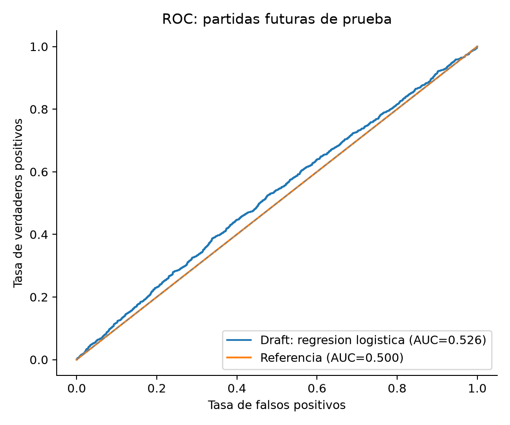
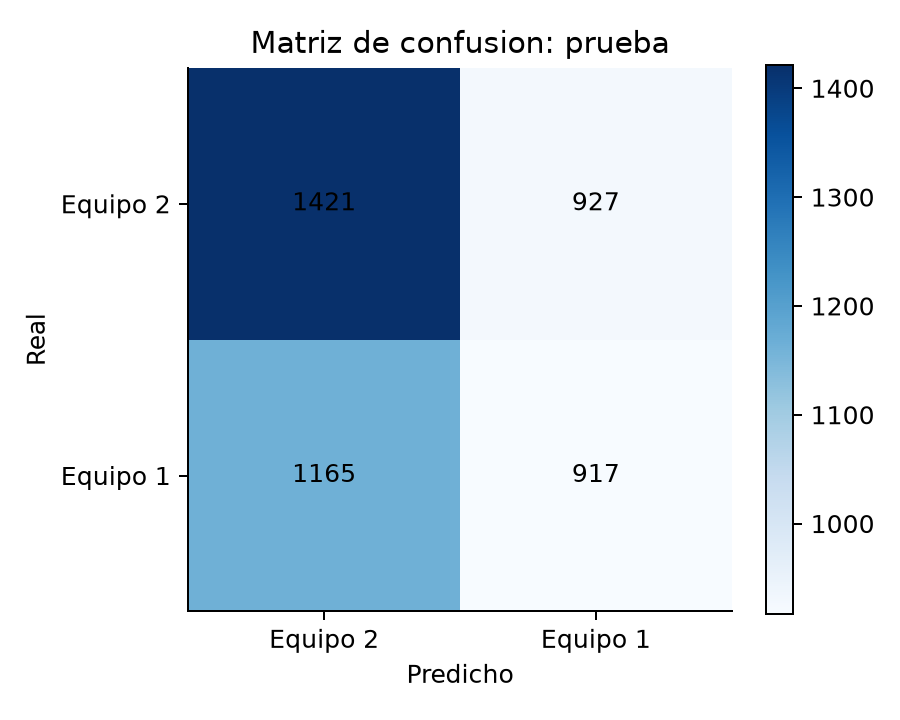
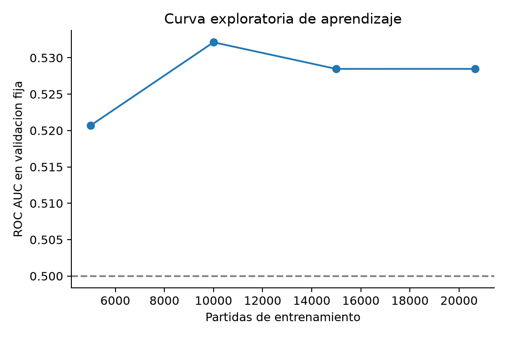
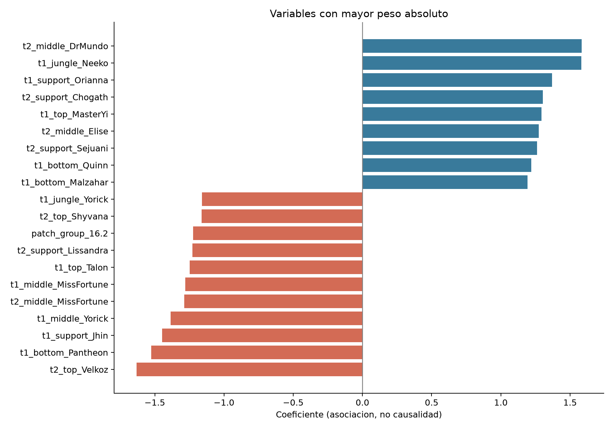

# Primer experimento de mineria

Partidas originales: 29,965. Partidas de al menos cinco minutos: 29,528.

## Clasificacion: ganador desde la seleccion de campeones

Entradas: diez campeones por rol y parche. Salida: victoria del equipo 1.
Se excluyen objetivos finales, duracion y rango actual para evitar informacion posterior al momento de prediccion.
Separacion temporal aproximada 70/15/15; se eliminan partidas de entrenamiento/validacion que terminan despues del inicio del siguiente bloque.
El encoder se aprende dentro de cada entrenamiento. C se elige en validacion y la prueba se evalua una vez tras reajustar con entrenamiento+validacion.

| Modelo | Accuracy | Balanced accuracy | ROC AUC | Log loss |
|---|---:|---:|---:|---:|
| draft_logistic | 0.5278 | 0.5228 | 0.5259 | 0.7086 |
| dummy_prior | 0.5300 | 0.5000 | 0.5000 | 0.6915 |

**Resultado:** la regresion logistica no supera a la referencia en accuracy (52.78% frente a 53.00%) ni en log loss. La AUC de 0.526 indica una capacidad discriminativa debil; este experimento no valida un predictor util por si solo.

El modelo Dummy predice con la frecuencia de clases del periodo de desarrollo; es la referencia a superar.
ROC AUC=0.5 representa una ordenacion al azar; valores superiores indican mayor capacidad de discriminar.

## Relacion entre objetivos tempranos y victoria

Reglas descriptivas: primera captura antes del minuto 15 y victoria. Se omiten tiempos sin equipo conocido y reglas con menos de 30 casos.
No se usan las banderas de primera sangre que discrepan entre fuentes. La confianza es la proporcion de victorias entre quienes cumplen la condicion; lift la compara con la tasa base del equipo.
Estas asociaciones no prueban que capturar un objetivo cause la victoria; tambien pueden reflejar una ventaja previa.

| Condicion | Casos | Confianza | Lift |
|---|---:|---:|---:|
| t2_first_tower_by_15min => t2_wins | 12,422 | 72.37% | 1.381 |
| t1_first_tower_by_15min => t1_wins | 12,224 | 68.09% | 1.430 |
| t1_first_dragon_by_15min => t1_wins | 10,973 | 63.43% | 1.332 |
| t2_first_dragon_by_15min => t2_wins | 17,965 | 62.21% | 1.187 |
| t2_first_horde_by_15min => t2_wins | 12,239 | 59.16% | 1.129 |
| t1_first_horde_by_15min => t1_wins | 17,143 | 52.46% | 1.102 |

## Aprendizaje con mas partidas

La curva usa subconjuntos aleatorios anidados del mismo bloque de entrenamiento y una validacion futura fija. Es una exploracion, no una garantia de que mas datos mejoren el resultado.

## Variables y limites

Los pesos son asociaciones del modelo y no una lista causal de campeones fuertes. Consultar tambien el numero de apariciones de cada variable.
metrics.json incluye fechas, parametros, version de dependencias y limitaciones. split_membership.csv identifica los grupos para reproducir la evaluacion.
Para predecir durante una partida hace falta un experimento separado que use exclusivamente eventos anteriores al minuto elegido.
