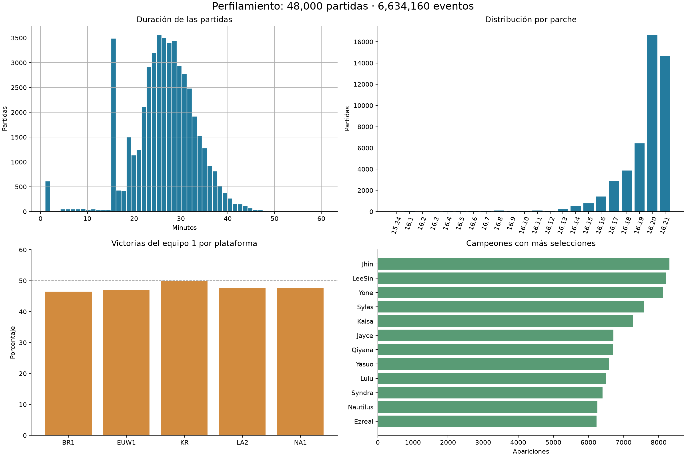

# Perfilamiento de ampliacion_50k_nuevos_parches

Generado: 2026-11-04T01:41:08.857893+00:00. Fuente: `C:\Users\ThePa\Documents\GitHub\lol-dataset-generator\data\weekend\ampliacion_50k_nuevos_parches`.

## Alcance y resultado

Lectura completa de los tres CSV, sin muestreo de eventos ni modificaciones de los datos originales. Se validaron claves, referencias entre archivos, JSON de cada evento, campos normalizados, orden por partida/frame/?ndice y coherencia de hitos y conteos. No se consultó la API ni se auditó SQLite.

| Archivo | Filas | Columnas | GB decimales |
| --- | --- | --- | --- |
| dataset.csv | 48,000 | 49 | 0.01 |
| milestones.csv | 48,000 | 18 | 0.01 |
| events.csv | 6,634,160 | 22 | 21.13 |

Las filas del resumen y de hitos son únicas por `match_id`; eventos únicos certificados: **True**. Partidas sin hitos: 0; sin eventos: 497; eventos huérfanos: 0. Errores estructurales no nulos: `{}`; errores en eventos no nulos: `{}`.

El resumen no tiene valores nulos: `{}`. Columnas constantes del resumen: `[]`. El diccionario completo de las 89 columnas está en [column_profile.csv](column_profile.csv).

## Estructura y unidades

- `dataset.csv`: una fila por partida; composición por rol, rango medio, resultado y objetivos finales. `game_duration` está en segundos y `game_creation` es un timestamp Unix en milisegundos.
- `milestones.csv`: una fila por partida; primer equipo y tiempo de ocho objetivos. Los tiempos están en milisegundos desde el inicio de la partida.
- `events.csv`: una fila por evento seleccionado por el recolector, no por cada evento posible de la API. `timestamp_ms` está en milisegundos y `minute` es su conversión a minutos. `raw_event` y `assisting_participant_ids` contienen JSON.
- `t1` corresponde al equipo 100 y `t2` al 200. `win_team1=True` indica victoria del equipo 1. El rango usa Master=1, Grandmaster=2 y Challenger=3; cero indica desconocido. El promedio se calcula solo sobre jugadores con rango conocido.

## Cobertura y equilibrio

Fechas de creación UTC: **2026-01-02T15:57:54.474000+00:00** a **2026-11-02T18:06:01.572000+00:00**. Equipo 1 gana **47.77%** (22,931 partidas); equipo 2 gana **52.23%**. La etiqueta está aproximadamente equilibrada; esto no certifica representatividad de la población.

| region | matches | team1_win_pct | duration_mean_min | duration_median_min | share_pct |
| --- | --- | --- | --- | --- | --- |
| BR1 | 9,167 | 46.43 | 26.59 | 27.00 | 19.10 |
| EUW1 | 9,971 | 47.07 | 26.58 | 26.68 | 20.77 |
| KR | 10,108 | 49.90 | 24.94 | 25.25 | 21.06 |
| LA2 | 9,004 | 47.65 | 27.35 | 27.80 | 18.76 |
| NA1 | 9,750 | 47.67 | 26.83 | 27.12 | 20.31 |

| patch_group | matches | team1_win_pct | duration_mean_min | duration_median_min | share_pct |
| --- | --- | --- | --- | --- | --- |
| 15.24 | 3 | 33.33 | 25.81 | 24.03 | 0.01 |
| 16.1 | 34 | 44.12 | 27.64 | 27.79 | 0.07 |
| 16.2 | 6 | 0.00 | 30.88 | 31.77 | 0.01 |
| 16.3 | 21 | 47.62 | 29.46 | 30.57 | 0.04 |
| 16.4 | 13 | 61.54 | 23.82 | 25.58 | 0.03 |
| 16.5 | 11 | 63.64 | 30.93 | 29.90 | 0.02 |
| 16.6 | 71 | 50.70 | 28.28 | 29.77 | 0.15 |
| 16.7 | 61 | 55.74 | 27.33 | 29.33 | 0.13 |
| 16.8 | 93 | 51.61 | 27.93 | 28.02 | 0.19 |
| 16.9 | 44 | 40.91 | 27.13 | 29.46 | 0.09 |
| 16.10 | 78 | 50.00 | 29.10 | 29.17 | 0.16 |
| 16.11 | 101 | 47.52 | 27.46 | 28.77 | 0.21 |
| 16.12 | 67 | 37.31 | 26.69 | 27.50 | 0.14 |
| 16.13 | 202 | 45.54 | 27.40 | 28.16 | 0.42 |
| 16.14 | 496 | 49.40 | 26.73 | 27.61 | 1.03 |
| 16.15 | 763 | 50.20 | 27.51 | 28.10 | 1.59 |
| 16.16 | 1,433 | 48.43 | 26.81 | 27.33 | 2.99 |
| 16.17 | 2,909 | 46.55 | 26.63 | 27.00 | 6.06 |
| 16.18 | 3,876 | 47.68 | 26.42 | 26.72 | 8.08 |
| 16.19 | 6,436 | 47.68 | 26.23 | 26.60 | 13.41 |
| 16.20 | 16,657 | 48.20 | 26.36 | 26.65 | 34.70 |
| 16.21 | 14,625 | 47.38 | 26.39 | 26.70 | 30.47 |

Los parches están agrupados por los dos primeros componentes de `patch`; los archivos originales conservan la versión completa. La distribución cruzada está en [patch_region_counts.csv](patch_region_counts.csv).

## Comparación con la muestra base

Base: **39,952** partidas; conservadas: **39,952**; faltantes: **0**; filas base modificadas: **0**. Partidas añadidas: **8,048**.

Parches nuevos: `{'16.20': 4733, '16.21': 3315}`. Nuevas fuera de 16.20/16.21: **0**. Las versiones antiguas proceden de la muestra base conservada.

## Duraciones y rangos

| Estadístico | Minutos |
| --- | --- |
| min | 1.00 |
| p05 | 15.28 |
| median | 26.77 |
| mean | 26.43 |
| p95 | 36.97 |
| max | 60.50 |

Partidas de menos de 5 minutos: **677** (1.41%); mayores de 60 minutos: **1**. El criterio de 1,5 IQR marca 1,327 duraciones atípicas; no prueba que sean erróneas. Las partidas cortas deben examinarse antes de decidir si corresponden a remakes o abandonos.

Rango medio igual a cero en al menos un equipo: **1,279** (2.66%). El cero codifica rango desconocido. El promedio usa jugadores conocidos localmente y no acredita el rango histórico de todos los participantes.

## Calidad semántica y desacuerdos entre fuentes

| Hallazgo | Partidas distintas | % de partidas |
| --- | --- | --- |
| champion_kill_count_disagreement | 6,793 | 14.15 |
| unknown_tier | 1,279 | 2.66 |
| milestone_time_without_team | 3,329 | 6.94 |
| first_flag_disagreement | 90 | 0.19 |
| duration_under_5min | 677 | 1.41 |
| no_exported_events | 497 | 1.04 |

Desacuerdos en conteos finales por campo: `{'t2_champion_kills': 3472, 't1_champion_kills': 3599}`. Los valores cuentan pares partida/campo; una misma partida puede afectar ambos equipos. El conteo del timeline incluye CHAMPION_KILL con killer_id positivo y atribución al actor. Estos desacuerdos no demuestran por sí solos cuál fuente es incorrecta.

Desacuerdos de primeras capturas entre resumen y timeline: `{'t1_first_blood': 87, 't2_first_blood': 83}`. Desacuerdos entre hitos y eventos: `{}`. Hitos con tiempo y sin equipo: `{'herald': 3287, 'horde': 45}`. Hitos con tiempo pero cero capturas finales: `{'herald': 3287, 'horde': 44}`.

Los nulos de hitos separan objetivos sin tiempo observado de tiempos conocidos sin equipo atribuible. No deben rellenarse todos con cero: se perdería esta distinción.

Los IDs de partidas afectadas y los deltas de bajas se entregan en [quality_flags.csv](quality_flags.csv).

## Hitos y objetivos

| objective | with_time | with_team | coverage_time_pct | median_first_min | first_team_win_pct |
| --- | --- | --- | --- | --- | --- |
| blood | 47,498 | 47,498 | 98.95 | 2.13 | 57.41 |
| tower | 46,940 | 46,940 | 97.79 | 13.29 | 69.65 |
| dragon | 47,087 | 47,087 | 98.10 | 8.10 | 62.70 |
| herald | 43,089 | 39,802 | 89.77 | 16.49 | 67.11 |
| horde | 47,129 | 47,084 | 98.19 | 8.70 | 55.42 |
| baron | 35,716 | 35,716 | 74.41 | 22.54 | 80.97 |
| atakhan | 3 | 3 | 0.01 | 20.97 | 66.67 |
| inhibitor | 37,246 | 37,246 | 77.60 | 25.57 | 91.61 |

Los tiempos se expresan en minutos; en el CSV fuente son milisegundos. La tasa de victoria del primer equipo que obtiene un objetivo es una asociación descriptiva, condicionada a que se conozca ese equipo; no representa un efecto causal. Una cobertura baja puede reflejar la duración o la disponibilidad del objetivo en distintos parches.

## Eventos y campos vacíos

| Tipo | Eventos | % |
| --- | --- | --- |
| CHAMPION_KILL | 2,689,849 | 40.55 |
| TURRET_PLATE_DESTROYED | 2,517,318 | 37.94 |
| BUILDING_KILL | 579,791 | 8.74 |
| ELITE_MONSTER_KILL | 401,214 | 6.05 |
| CHAMPION_SPECIAL_KILL | 390,700 | 5.89 |
| DRAGON_SOUL_GIVEN | 55,288 | 0.83 |

Eventos por partida, incluyendo las partidas con cero eventos: `{'min': 0, 'p05': 58.0, 'median': 143.0, 'mean': 138.21166666666667, 'p95': 201.0, 'max': 289}`. Comprobaciones adicionales: `{'events_after_exact_duration': 10, 'champion_kills_without_actor_team': 7984, 'champion_kills_with_killer_zero': 7984, 'invalid_killer_id_domain': 0, 'invalid_victim_id_domain': 0, 'partial_position': 0}`. La auditoría principal admite hasta 120 segundos de margen respecto a la duración final; el contador adicional events_after_exact_duration usa el límite exacto.

Los campos de monstruos, edificios, víctimas y tipos de baja son condicionales al tipo de evento. Su ausencia global no debe interpretarse automáticamente como pérdida de datos. El desglose está en [event_missing_by_type.csv](event_missing_by_type.csv). Cada raw_event y lista de asistentes fue parseado por el auditor; raw_event no se trata como un predictor numérico.

## Nulos de hitos

| Campo | Nulos | % |
| --- | --- | --- |
| first_blood_team | 502 | 1.05 |
| first_blood_time | 502 | 1.05 |
| first_tower_team | 1,060 | 2.21 |
| first_tower_time | 1,060 | 2.21 |
| first_dragon_team | 913 | 1.90 |
| first_dragon_time | 913 | 1.90 |
| first_herald_team | 8,198 | 17.08 |
| first_herald_time | 4,911 | 10.23 |
| first_horde_team | 916 | 1.91 |
| first_horde_time | 871 | 1.81 |
| first_baron_team | 12,284 | 25.59 |
| first_baron_time | 12,284 | 25.59 |
| first_atakhan_team | 47,997 | 99.99 |
| first_atakhan_time | 47,997 | 99.99 |
| first_inhibitor_team | 10,754 | 22.40 |
| first_inhibitor_time | 10,754 | 22.40 |

## Distribuciones



## Criterios para preparar minería o modelos

1. Separar variables previas al juego de objetivos y resultados finales; usar estos últimos para predecir desde el draft produciría fuga de información.
2. Para predicción durante la partida, usar solo eventos anteriores al instante de corte y particionar por match_id para evitar compartir una partida entre entrenamiento y evaluación.
3. Evaluar por tiempo, parche y plataforma. La mezcla de versiones es desigual y el aumento cambia su composición; una partición aleatoria no mide por sí sola generalización a futuros parches.
4. Codificar rango desconocido y objetivos no observados de forma explícita. Verificar disponibilidad por parche antes de interpretar un cero como una captura posible no realizada.
5. Elegir y documentar la fuente de verdad para primeras bajas y conteos; usar quality_flags.csv para revisar o segmentar discrepancias antes de entrenar.
6. Definir una política de duración corta acorde al objetivo del análisis; los CSV originales se conservan íntegros.

## Método, límites y reproducción

Las estadísticas de resumen e hitos y los conteos de eventos son exhaustivos. Los percentiles de eventos por partida son exactos; no se calcularon percentiles numéricos por evento. La cardinalidad de eventos solo se calculó para campos categóricos; las demás celdas de cardinalidad se dejan vacías. La unicidad de event_id se certifica por su composición y orden global estricto, según el auditor existente. Se verificó que tamaños y fechas de modificación de los archivos no cambiaran durante la lectura; no se calcularon hashes de los archivos fuente.

```powershell
.\.venv\Scripts\python.exe analysis/profile_dataset.py --data-dir "data\weekend\ampliacion_50k_nuevos_parches" --output-dir "reports\perfilamiento_50k_nuevos_parches" --base-dir "data\weekend\ampliacion_40k"
```

Los resultados detallados están en [data_review.json](data_review.json), [numeric_summary.csv](numeric_summary.csv), [champions_by_role.csv](champions_by_role.csv) y las tablas de distribución. El informe de auditoría original se conserva en [data_review.md](data_review.md).
